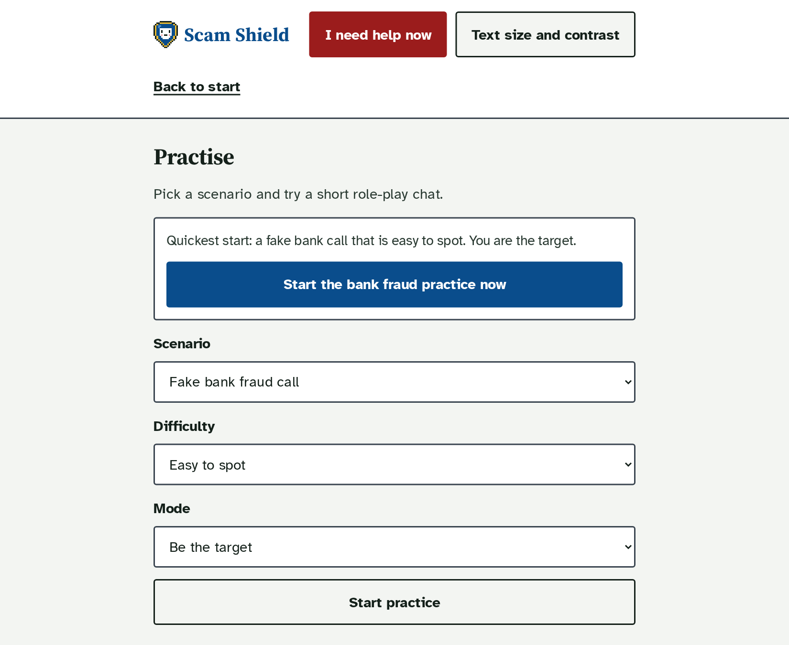
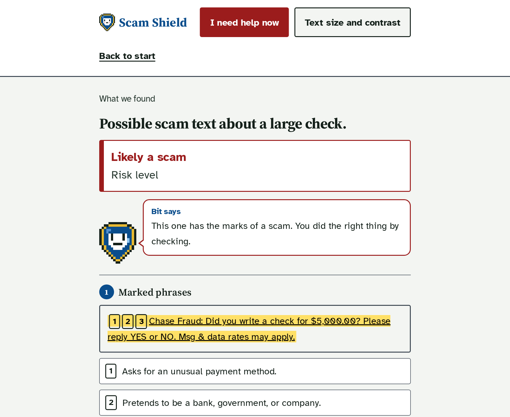
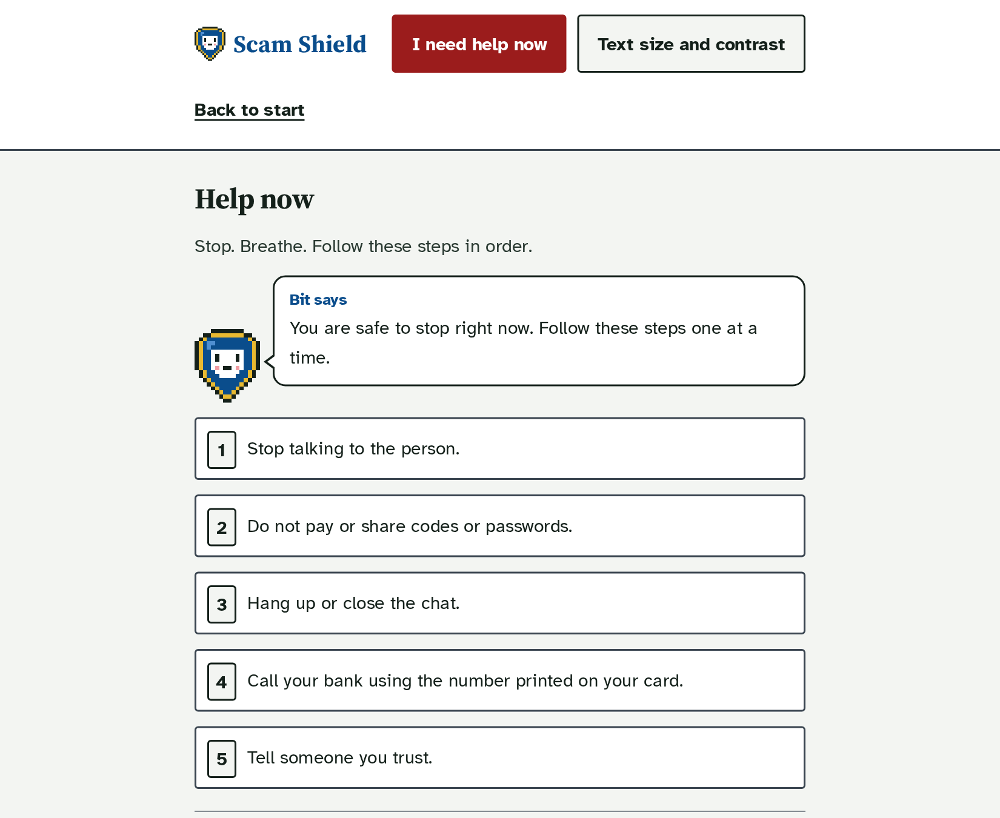
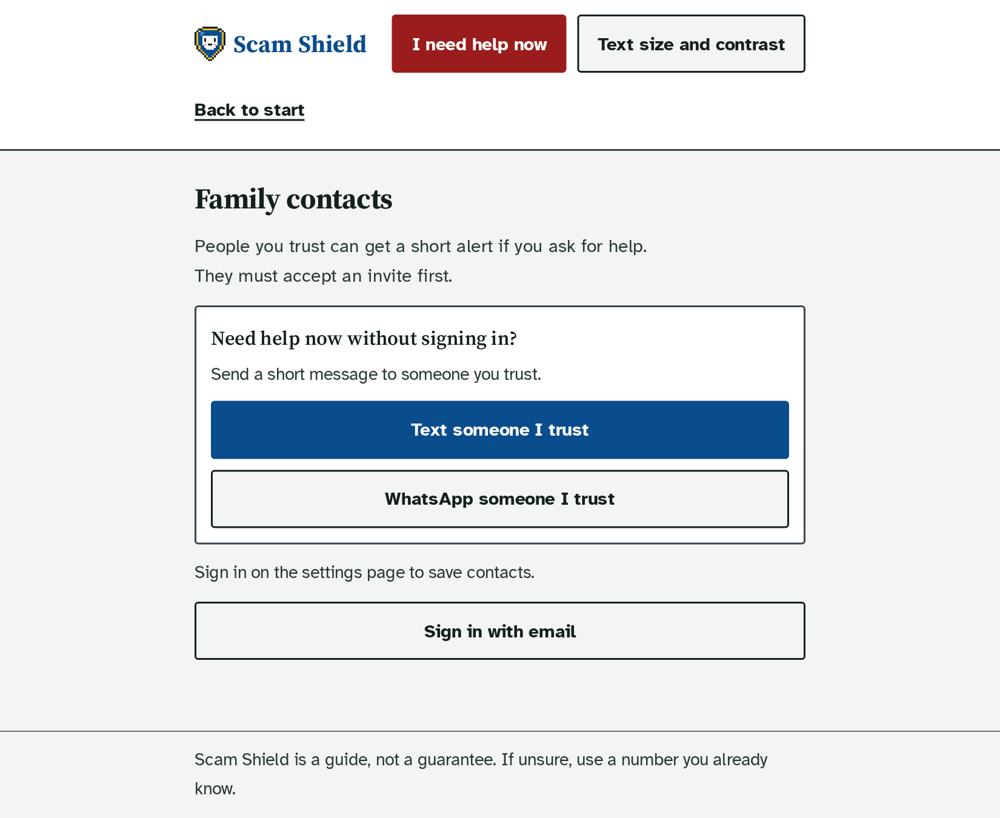
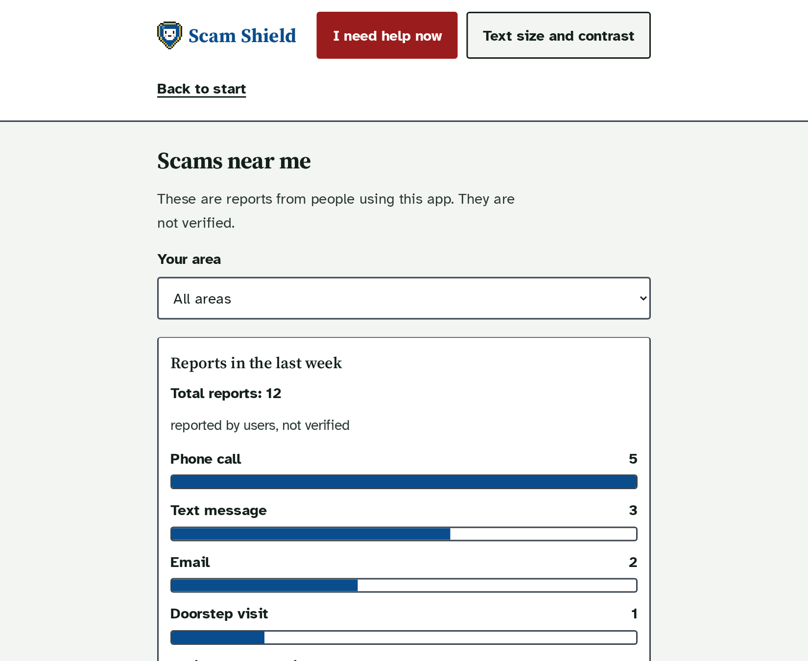
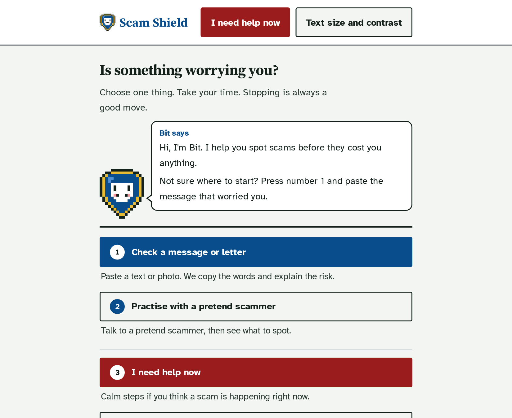
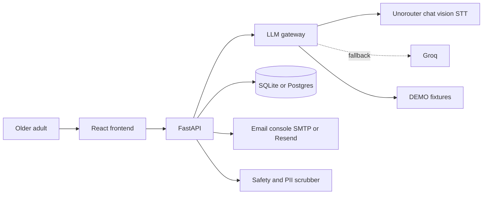

# Scam Shield

> **Status: Submitted.** Scam Shield is complete and was submitted to the hackathon on 24 November 2026.

Scam Shield is a calm web app that helps older adults practise hanging up on pretence scammers, check worrying messages, and reach trusted people quickly. It is built for a student social-impact hackathon and for people who are not tech experts. Judges can clone the repo, follow this README, and run a full demo in under ten minutes with or without an API key.

## The problem

Imposter scams (bank, government, grandchild, tech support, romance) cause high losses for older adults. Common red flags include unexpected contact, urgency, secrecy, threats, requests for one-time codes, and unusual payment methods. FTC data for 2024 shows that among older adults who lost $10,000 or more to business or government imposters, 41% said a phone call was the first contact; payment methods included crypto 33%, bank transfer 20%, and cash 16% ([FTC Consumer Sentinel / Data Spotlight](https://www.ftc.gov/news-events/data-visualizations/data-spotlight)).

## Why simulation

A CHI 2026 study (ROLESafe, 144 older adults) found that practising as the target ("Experiencer") and advising a simulated victim ("Helper") both improved fraud identification versus static material, and Helpers beat passive Observers. Group differences were **not** seen at follow-up, so this app includes both modes and an optional "remind me to practise" refresher rather than a one-off lesson.

Tone rule: never shame. Scammers are professionals. Stopping is always a good move.

## Watch the 50-second demo

[`docs/scam-shield-hackathon.mp4`](docs/scam-shield-hackathon.mp4): Bit, our mascot, walks through Margaret's real-life case, from a fake "account locked" text to every feature, using the live app.

## Meet Bit

Bit is Scam Shield's pixel-art shield mascot. Bit greets people on the home screen, reacts to each result (happy, calm, worried, thinking) and gives one plain tip at a time. Everything Bit says is real text, so screen readers read it too. Home choices are numbered 1 to 5, so a family member can say "press number 1" over the phone.

## Features

1. **Practise** — pretend scammer chat (and optional voice), then a debrief with marked moments.  
   
2. **Check a message** — paste text or photograph a letter; get a risk label, highlights, and next steps.  
   
3. **Help now** — calm steps for "I think I am being scammed right now".  
   
4. **My family** — trusted contacts with invitation consent, email alerts, and share-link fallback.  
   
5. **Scams near me** — anonymous reports and a simple weekly area summary.  
   

Home screen:



## How it works



- **LLM gateway** — only module that talks to the AI provider (Unorouter, Groq fallback); retries, fallbacks, structured validation, DEMO fixtures.
- **Analyzer** — text and image checks with exact quote verification.
- **Scenario / drills** — practice sessions, helper mode, debrief.
- **Safety / PII** — hide real secrets, strip real links/numbers, scrub reports.
- **Auth / family / alerts** — passwordless email code, double opt-in, rate-limited alerts.
- **Reports / content** — anonymous area summary and region help packs.

See [docs/ARCHITECTURE.md](docs/ARCHITECTURE.md).

## Quick start in 5 minutes (no API key)

Requirements: Python 3.11+, Node 20+, Make. Docker optional.

```bash
git clone <your-repo-url> scam-shield
cd scam-shield
cp .env.example .env
# DEMO_MODE=true is already the default

# Backend
cd backend
python3 -m venv .venv
# Windows: py -3 -m venv .venv && .venv\Scripts\activate
# macOS/Linux:
source .venv/bin/activate
pip install -e ".[dev]"
uvicorn app.main:app --reload --port 8000

# Frontend (new terminal)
cd frontend
npm install --legacy-peer-deps
npm run dev
```

Open http://localhost:5173 — the API is http://localhost:8000 (docs at `/docs`).

Or with Make (after venv + npm install once):

```bash
make dev-backend
make dev-frontend   # other terminal
```

Docker:

```bash
docker compose up --build
```

## Using real AI with Unorouter

Scam Shield's AI runs through the [Unorouter](https://api.unorouter.com) gateway (OpenAI-compatible), as the hackathon requires. Groq stays as an optional fallback provider.

1. Get a Unorouter API key.
2. Set in `.env`:
   - `DEMO_MODE=false`
   - `UNOROUTER_API_KEY=...`
   - Models default to `gemini-2.5-flash` (chat, vision), `gemini-2.5-flash:free` (fast fallback) and `whisper-large-v3-turbo:free` (speech to text). Change them with `UNOROUTER_*_MODEL`.
3. Run `python scripts/check_llm.py` to confirm the key works and every configured model exists.
4. `LLM_PROVIDER=auto` (default) uses Unorouter whenever its key is set, otherwise Groq (`GROQ_*` variables). Force one with `LLM_PROVIDER=unorouter` or `groq`.
5. On HTTP 429 the gateway backs off, falls back to the fast model, then to the local rule checker, and shows: "The checker is busy. Please try again in a minute."

## Environment variables

| Name | Example | Required | What it does |
| --- | --- | --- | --- |
| `DEMO_MODE` | `true` | no | Offline fixtures; default for judges |
| `DATABASE_URL` | `sqlite:///./scam_shield.db` | no | SQLite or Postgres URL |
| `CORS_ORIGINS` | `http://localhost:5173` | no | Allowed frontends |
| `JWT_SECRET` | long random string | yes in prod | Signs auth tokens |
| `REGION_DEFAULT` | `uk-example` | no | Help now pack (`generic` or `uk-example`) |
| `LLM_PROVIDER` | `auto` | no | `auto` \| `unorouter` \| `groq` |
| `UNOROUTER_API_KEY` | | if not demo | Unorouter key (primary AI) |
| `UNOROUTER_BASE_URL` | `https://api.unorouter.com/v1` | no | Gateway URL |
| `UNOROUTER_CHAT_MODEL` | `gemini-2.5-flash` | no | Main model |
| `UNOROUTER_FAST_MODEL` | `gemini-2.5-flash:free` | no | Fallback model |
| `UNOROUTER_VISION_MODEL` | `gemini-2.5-flash` | no | Photo check when OCR finds no text |
| `UNOROUTER_STT_MODEL` | `whisper-large-v3-turbo:free` | no | Voice practice speech to text |
| `GROQ_API_KEY` | | no | Optional fallback provider |
| `GROQ_CHAT_MODEL` | | if not demo | Chat model id |
| `GROQ_FAST_MODEL` | | no | Fallback chat model |
| `GROQ_VISION_MODEL` | | if images live | Vision model id |
| `GROQ_STT_MODEL` | | if voice live | Whisper model id |
| `ENABLE_PROMPT_GUARD` | `false` | no | Optional injection classifier |
| `STORE_INPUTS` | `false` | no | Store analyzer inputs |
| `STORE_TRANSCRIPTS` | `false` | no | Store drill turns |
| `MIN_REPORTS_TO_SHOW` | `3` | no | Area summary threshold |
| `EMAIL_BACKEND` | `console` | no | `console` \| `smtp` \| `resend` |
| `SMTP_*` / `RESEND_*` | | if email | Mail settings |
| `VAPID_*` | | optional | Web Push |
| `RATE_LIMIT_*` | | no | Per-minute limits |

Full template: [.env.example](.env.example).

## Using the app

- **Home** — four large buttons for the main tasks.
- **Check** — paste or photo, wait for plain "Checking…" text, then read the result page.
- **Practise** — pick scenario, difficulty, Be the target or Help the victim; hang up for debrief.
- **Help now** — numbered steps and who to contact from the region pack.
- **My family** — sign in, add people, wait for accept, send test alert or share links.
- **Scams near me** — pick an area, read the weekly summary, optionally report.
- **Text size and contrast** — enlarge text, high contrast, read aloud, sign in, delete data.

## API reference

See [docs/API.md](docs/API.md) and interactive docs at `/docs`.

```bash
curl -s -X POST http://localhost:8000/api/analyze/text \
  -H 'Content-Type: application/json' \
  -d '{"text":"This is Metro Trust Bank Fraud Unit. Share the one-time code."}'
```

## Data and privacy

- No account needed for Practise, Check, Help now, or reading summaries.
- Account (email code) needed for family contacts and push.
- Analyzer inputs and drill transcripts off by default.
- Reports store scrubbed text, area, scam type, and a salted IP hash for rate limits only.
- `DELETE /api/me` removes the user and linked data. Settings also offers "Delete all my data".

## Safety and ethics

See [docs/SAFETY.md](docs/SAFETY.md). Guardrails on the scammer persona, fictional names only, consent for alerts. Risk labels are a guide, not a guarantee. Not legal or financial advice.

## Accessibility

Design targets AAA-oriented contrast and 56 px targets, skip link, visible focus, no animation, plain language. Automated axe and contrast tests ship with the repo. Older-adult live test: **not yet completed** — see [docs/ACCESSIBILITY.md](docs/ACCESSIBILITY.md).

## Testing

```bash
make check          # ruff, pytest, oxlint, tsc, vitest, eval_safety, contrast
make test-backend
make test-frontend
python scripts/eval_safety.py
```

## Deploying

1. **Frontend (Vercel):** import the `frontend` folder, set `VITE_API_URL` to your API origin, deploy.
2. **Backend (Render / Railway):** deploy `backend`, start `uvicorn app.main:app --host 0.0.0.0 --port $PORT`.
3. **Database:** attach Postgres; set `DATABASE_URL`; run Alembic migrations (`cd backend && alembic upgrade head`) or rely on startup `create_all` for demos.
4. Set `DEMO_MODE=false`, `JWT_SECRET`, `CORS_ORIGINS`, `UNOROUTER_API_KEY` and email vars.
5. Post-deploy checklist: health endpoint, analyze in demo then live, invitation email, CORS from the Vercel origin, Help now region pack.

## Troubleshooting

| Symptom | What to try |
| --- | --- |
| Unorouter / Groq 429 | Wait; use DEMO_MODE; check per-model limits |
| Invalid JSON from model | Gateway repairs once; then shows busy message |
| Model not found | Run `scripts/check_llm.py` and update env IDs |
| Photo too large | Client downscales to ≤1600 px JPEG |
| Microphone blocked | Browser permission; Record button hidden if unsupported |
| iPhone push silent | Needs Add to Home Screen (iOS 16.4+); use email/share links |
| Emails missing | `EMAIL_BACKEND=console` prints to server log in demo |

## Before you demo

### TODO placeholders (do not invent numbers)

- Region packs ship verified contacts: UK Action Fraud `0300 123 2040`, Police Scotland `101`, and FTC ReportFraud for the generic pack (`backend/app/data/regions/*.json`). Default region is `uk-example`.
- Screenshots live under `docs/screenshots/` (home, check, practise, help, family, scams).

### Day-before checks

- [ ] `make check` passes
- [ ] `DEMO_MODE=true` walkthrough of Practise + Check + Help now
- [ ] Unorouter key path verified with `scripts/check_llm.py`
- [ ] Family invite accept flow with console email
- [ ] High contrast and Extra large text

## Demo script

See [docs/DEMO_SCRIPT.md](docs/DEMO_SCRIPT.md) (about 90 seconds).

## Devpost submission checklist

- [ ] Title: Scam Shield
- [ ] Tagline: Practise hanging up. Check a message. Tell someone you trust.
- [ ] Description (impact, how it works, DEMO_MODE)
- [ ] Demo video link
- [ ] Repo link
- [ ] Build instructions (this README)
- [ ] Team names

## Limitations and roadmap

- Open models can break character; safety layer and DEMO fixtures mitigate demos.
- Speech quality varies by device browser.
- Area reports are unverified user submissions.
- Roadmap: stronger region packs with verified links, second language pack, CSV export of anonymous aggregates.

## Evidence and credits

- [FTC Data Spotlight on older adults and imposter scams](https://www.ftc.gov/news-events/data-visualizations/data-spotlight)
- CHI 2026 ROLESafe (Experiencer / Helper / Observer findings; follow-up caveat)
- [WCAG 2.2](https://www.w3.org/TR/WCAG22/)
- [NCOA guidance on imposter scams](https://www.ncoa.org/)
- U.S. Senate Special Committee on Aging fraud resources
- [Groq docs](https://console.groq.com/docs)
- Decisions: [docs/DECISIONS.md](docs/DECISIONS.md)

Licence: [MIT](LICENSE). Built for Code for Change / Devpost.

## Final build report

**Built:** full FastAPI + React app with DEMO_MODE fixtures, Check, Practise (experience + helper), Help now, Family double opt-in, Scams near me, optional voice STT, optional push stubs, accessibility controls, tests, and docs.

**Stubbed / light:** live AI depends on Unorouter model IDs; Web Push needs VAPID keys; region hotlines are TODO placeholders; older-adult live test not yet run.

**Risky for demo day:** free-tier model 429s under parallel judging; speechSynthesis voice set differs by OS; iPhone push only after Home Screen install.

**Three things to check by hand before demo day:** (1) full Practise hang-up debrief in DEMO_MODE, (2) Check result highlights on the sample bank text, (3) family invite accept + console email alert.
