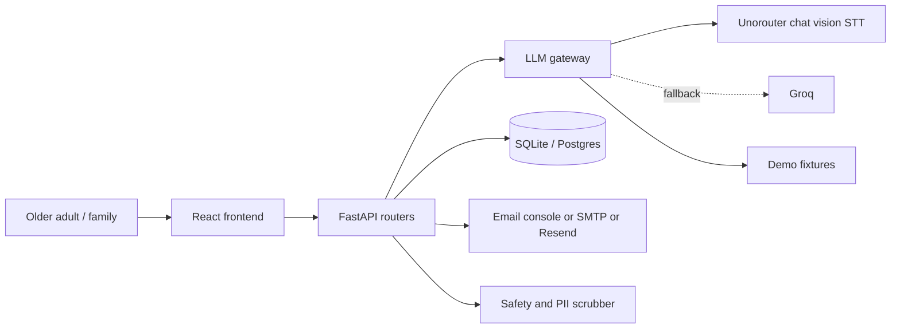

# Architecture

Scam Shield is a calm public-service web app: a React (Vite) frontend talks to a FastAPI backend. The backend owns all AI calls through a single LLM gateway, stores family and report data, and can run fully offline in `DEMO_MODE`.

## Frontend

- One column layout, design tokens, accessibility controls in localStorage.
- Screens map to features: Check, Practise, Help now, My family, Scams near me.
- Read aloud uses browser `speechSynthesis`. Photo check downscales in the browser before upload.
- PWA shell can show Help now offline when installed.

## Backend services

| Service | Role |
| --- | --- |
| LLM gateway | Only AI client (Unorouter primary, Groq fallback); retries, fallbacks, structured output validation, DEMO fixtures |
| Analyzer | Text and image risk check with quote verification |
| Scenario / drills | Pretend scammer and helper modes, debrief |
| Safety | Strip real numbers/links, hide real PII, refuse how-to-scam |
| Auth | Passwordless email code, JWT |
| Family / alerts | Double opt-in contacts, rate-limited alerts, share links |
| Reports | Anonymous scrubbed reports and weekly area summary |
| Content | Region help packs |
| Voice | Whisper transcription (browser TTS) |
| Push | Optional Web Push |

## Data

Users, family contacts, invitations, drill sessions (24 h TTL), optional turns, reports, push subscriptions, alert log. Inputs and transcripts are off by default.
